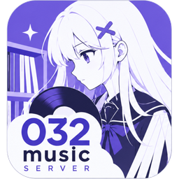

<p align="center"></p>

# 032 Music Server

**简体中文** | [English](README.en.md)

一个用 Go 编写的自托管音乐库和串流服务。它优先采用本地标签和人工编辑，提供以专辑为中心的 Web 播放器和管理界面，也为配套客户端提供 JSON API。

**项目定位：日本 ACG 优先。** 元数据匹配和作品关联主要面向日本动画、游戏和同人音乐，支持日文标题、假名索引和读音排序标签。普通电影和电视剧不在主要适配范围内，匹配质量不作保证。


## 功能

- **本地曲库**：自动增量扫描，监控目录变化后自动入库；支持多碟专辑，能识别新增、修改和丢失的文件。格式支持 FLAC、MP3、M4A/AAC、Ogg、Opus。
- **浏览与编辑**：按专辑、歌手、创作者、作品、系列浏览，支持搜索、假名索引、收藏和歌单。人工修改单独保存，**不会改写音乐文件**，重扫也不会覆盖。
- **网页播放器**：队列、随机/循环、全屏歌词，站内切换页面时播放不中断。
- **媒体服务**：原文件串流（支持 Range），实时转码 MP3/Opus，封面缩略图。
- **可选增强**：MusicBrainz / Last.fm / Bangumi 元数据、Last.fm Scrobble、Sonos/DLNA 投送、本地声学分析、AI 打标和每日推荐。

## 快速部署（Docker Compose）

**前提**：已安装 Git 和 Docker（需要带 Compose v2，命令为 `docker compose`）。Windows/macOS 用 Docker Desktop 即可。

### 1. 下载代码

```sh
git clone https://github.com/lux032/032music-server.git
cd 032music-server
cp .env.example .env          # Windows PowerShell: Copy-Item .env.example .env
```

### 2. 编辑 `.env`

至少需要修改下面 **4 项**，其余保持默认即可：

```dotenv
# 音乐所在目录（宿主机上已存在的路径，以只读方式挂载）。Windows 示例：D:/Music
MUSIC_SERVER_MUSIC_PATH=/srv/music

# 管理员密码，至少 12 个字符
MUSIC_SERVER_ADMIN_PASSWORD=换成你自己的密码

# 两个不同的随机 Token，各至少 24 个字符
MUSIC_SERVER_API_TOKEN=第一个随机值
MUSIC_SERVER_MEDIA_TOKEN=第二个随机值
```

生成随机 Token（执行两次，分别填入）：

```sh
openssl rand -hex 24
```

```powershell
# Windows PowerShell 7
[Convert]::ToHexString([Security.Cryptography.RandomNumberGenerator]::GetBytes(24)).ToLowerInvariant()
```

> 数据库、设置、歌单和缓存默认保存在仓库下的 `./data`（由 `MUSIC_SERVER_DATA_PATH` 指定），不要把它放进音乐目录。`.env` 中有密码，请妥善保管，不要提交到 Git。

### 3. 启动

```sh
docker compose up -d --build
docker compose logs -f music-server     # 查看日志，Ctrl+C 退出
```

第一次启动需要构建镜像，大约需要几分钟。

### 4. 打开

浏览器访问 **`http://服务器IP:4533/admin`**（在本机就是 `http://localhost:4533/admin`），用户名为 `admin`，密码是 `.env` 中设置的密码。

启动后会自动扫描曲库，扫描进度在「概览」页查看。曲库很大时首次扫描需要一些时间，扫描结束前页面上的歌曲可能不全。

> **Linux / NAS 上出现 `permission denied`？** 容器以非 root 用户运行，需要对数据目录有写权限。解决方法见 [部署进阶 → 目录权限](docs/deployment.md#目录权限linux--nas)。

## 日常维护

| 操作 | 命令 |
|---|---|
| 查看状态 | `docker compose ps` |
| 停止 / 启动 | `docker compose stop` / `docker compose start` |
| 修改 `.env` 后生效 | `docker compose up -d`（`restart` **不会**读取新配置） |
| 升级到最新版 | `git pull --ff-only && docker compose up -d --build` |
| 备份 | 停止服务后备份 `.env` 和整个 `data` 目录 |

升级时会自动迁移数据库，**升级前请先备份**，旧版本不一定能读取升级后的数据库。详见 [备份与升级](docs/deployment.md#备份与升级)。

## 按需配置

| 我想… | 怎么做 |
|---|---|
| 通过域名 + HTTPS 从外网访问 | 放在反向代理后面，并设置 `MUSIC_SERVER_COOKIE_SECURE=true`，见 [HTTPS 与反向代理](docs/deployment.md#https-与反向代理) |
| 改用其他端口 | 修改 `.env` 中的 `MUSIC_SERVER_PORT` |
| 不在本机构建镜像 | [使用预构建镜像](docs/deployment.md#使用预构建镜像) |
| 投送到 Sonos / DLNA 音箱 | 设置 `MUSIC_SERVER_CAST_BASE_URL`，见 [投送](docs/deployment.md#投送到-sonos--dlna) |
| 获取歌手资料、动画/游戏作品关联 | 在 管理 → 设置 → 元数据 中启用，见 [元数据与作品关联](docs/features.md#元数据与作品关联) |
| 同步播放记录到 Last.fm | 见 [Last.fm Scrobble](docs/features.md#lastfm-播放记录scrobble) |
| 每日推荐歌单、声学相似度 | 部署 [声学分析服务](docs/deployment.md#声学分析服务)，再配置 [AI 打标](docs/features.md#ai-打标) 和 [每日推荐](docs/features.md#每日推荐) |
| 忘记管理员密码 | 见 [恢复凭据](docs/configuration.md#管理页修改与恢复凭据) |
| 查看所有环境变量 | [配置参考](docs/configuration.md) |

遇到问题先查看 [常见问题](docs/deployment.md#常见问题)。

## 文档

- [部署进阶](docs/deployment.md)：权限、反向代理、投送、声学分析、预构建镜像、备份升级、常见问题
- [配置参考](docs/configuration.md)：全部环境变量与凭据管理
- [功能说明](docs/features.md)：元数据增强、Scrobble、AI 打标、每日推荐、投送
- [API 参考](docs/api/README.md)：客户端接口、认证、播放上报协议、媒体行为
- [本地开发与测试](docs/development.md)
- [声学分析服务](analyzer/README.md)

## 许可证

[MIT](LICENSE)。声学分析使用的 MTG Essentia 模型采用 CC BY-NC-SA 4.0 许可，仅限非商业用途。
